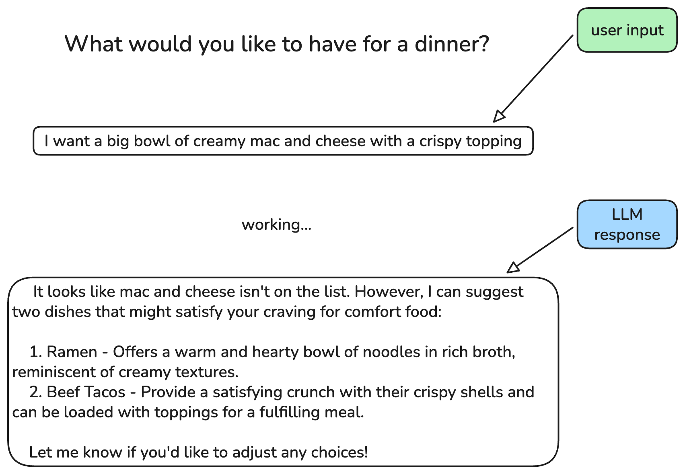

# llm-observability-demo-langfuse

A small demo that mocks a system which recommends users a dish for a dinner.
It uses the OpenAI API to generate a meal plan from a randomly rotating menu,
tailored to the user's request.



## Setup

1. Install [uv](https://docs.astral.sh/uv/).
2. Create a `.env` file with your OpenAI API key:

   ```
   OPENAI_API_KEY=sk-...
   ```

## Run

```
uv run main.py
```

`uv` will install the dependencies automatically on first run.
